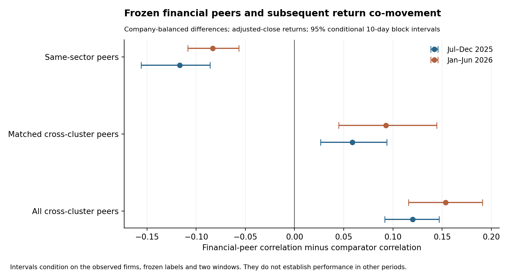

# Frozen financial peers: forward co-movement experiment

The frozen UMAP financial peers co-move more than cross-cluster alternatives, including sector-and-formation-characteristic-matched alternatives. They co-move **less than same-sector peers in both six-month windows**. The proposed claim of stronger subsequent co-movement than conventional sectors is not supported by this experiment.

This is a separate company-balanced experiment and does not write to the manuscript or the original numerical archive. Parallel commits have added a pair-weighted analysis to the paper. Those estimates and the company-balanced estimates here answer differently weighted questions and should not be spliced together.



## Design and scope

- Frozen source run: `20261115T062631-0c09819ce3c0`, representative seed 42. Manuscript baseline: commit `7a860a0`. No refitting, feature selection or parameter tuning uses forward returns.
- Formation 30 June 2025 is evaluated on 1 July–31 December 2025; formation 31 December 2025 on 1 January–30 June 2026. The return from the formation close to the first evaluation close is included.
- All 41 formation-date instruments are retained, even if they subsequently leave the index. No future membership filter is applied. Coverage is 128 and 123 trading-day returns, respectively.
- INL and INP receive one combined focal-company weight. Their mutual pair is excluded. Other companies receive equal weight, rather than giving large clusters weight proportional to their number of pairs.
- The primary comparison is within-cluster versus same-sector mean correlations for the same eligible focal companies. Sector pairs may also be cluster pairs. Missing peer sets are reported as ineligible, not assigned zero correlation.
- Matched alternatives keep the focal instrument fixed and match each cluster peer to a different-cluster instrument in the same recorded sector, nearest in formation-standardised log line market capitalisation and annualised volatility. Matching is with replacement and uses no forward outcomes. Each company’s matched contrast uses only its successfully matched targets.
- Primary returns use Yahoo adjusted closes. Vendor close price returns and J200-residual adjusted returns are sensitivities. The close-price series may already incorporate vendor split adjustments; it is not a reconstructed raw transaction-price history.
- The protocol was recorded before this experiment ran, but after the wider study and a beta audit. It is a retrospective analysis protocol, not a prospective preregistration.

## Primary estimates

Positive differences favour financial peers. Levels are company-balanced arithmetic means of Pearson correlations for the eligible companies in that comparison; different comparisons may have different coverage. Intervals are conditional return-panel resampling intervals, not an independent-pair significance test.

| Formation | Comparator | Eligible companies | Cluster mean | Comparator mean | Difference | 95% conditional interval |
|---|---|---:|---:|---:|---:|---|
| 2025-06-30 | Same-sector peers | 38 | 0.250 | 0.366 | -0.117 | [-0.156, -0.086] |
| 2025-06-30 | Matched cross-cluster peers | 40 | 0.244 | 0.185 | +0.059 | [+0.026, +0.094] |
| 2025-06-30 | All cross-cluster peers | 40 | 0.247 | 0.127 | +0.120 | [+0.092, +0.147] |
| 2025-12-31 | Same-sector peers | 37 | 0.382 | 0.465 | -0.083 | [-0.109, -0.057] |
| 2025-12-31 | Matched cross-cluster peers | 37 | 0.300 | 0.207 | +0.093 | [+0.045, +0.145] |
| 2025-12-31 | All cross-cluster peers | 38 | 0.382 | 0.228 | +0.153 | [+0.116, +0.191] |

## Dependence, uncertainty and sensitivity

Each date uses 2,000 synchronous circular moving-block resamples at block lengths of 5, 10 and 20 trading days. All companies share each resampled calendar, preserving common cross-sectional shocks. The displayed intervals use 10 days. These intervals condition on the observed corporate universe and fitted groups; two windows do not establish a sampling distribution across market regimes. Company-level contrasts and deletion sensitivity accompany the intervals; no test treats the many overlapping equity pairs as independent observations.

High-volatility exclusions use only the formation-date 90th-percentile threshold, not realised forward volatility. Market residuals remove a same-window intercept and J200 slope; these are a correlation diagnostic, not a tradable hedging strategy.

| Formation | Return/coverage sensitivity | Sector difference | Matched difference |
|---|---|---:|---:|
| 2025-06-30 | adjusted | -0.117 | +0.059 |
| 2025-06-30 | price | -0.117 | +0.059 |
| 2025-06-30 | exclude_high_formation_volatility | -0.129 | +0.041 |
| 2025-06-30 | J200_residual | -0.116 | +0.084 |
| 2025-12-31 | adjusted | -0.083 | +0.093 |
| 2025-12-31 | price | -0.083 | +0.093 |
| 2025-12-31 | exclude_high_formation_volatility | -0.103 | +0.079 |
| 2025-12-31 | J200_residual | -0.112 | +0.095 |

| Formation | Delete-one-company sector range | Delete-one-company matched range |
|---|---|---|
| 2025-06-30 | [-0.126, -0.082] | [+0.029, +0.074] |
| 2025-12-31 | [-0.096, -0.038] | [+0.065, +0.118] |

The sector contrast remains negative and the matched contrast positive after deleting any single economic company. The output interval table supplies every block-length and sensitivity result, including results not displayed here.

## Matching coverage

| Formation | Matched directed targets | Unmatched targets | Mean / maximum matching distance | Distinct alternatives reused |
|---|---:|---:|---|---:|
| 2025-06-30 | 198 | 16 | 0.565 / 1.911 | 26 |
| 2025-12-31 | 161 | 61 | 0.683 / 1.465 | 19 |

Distances are Euclidean in the two standardised formation attributes. Exact sector matching is not possible for every directed target. The matched estimates apply only to the successfully matched subset and do not establish an advantage over sectors. Repeated alternatives and imperfect characteristic balance constrain interpretation; `matched_pairs.csv` records every selection and its distance.

## Descriptive diagnostics added after the primary run

These pair-weighted breakdowns explain the result and are exploratory rather than additional confirmatory hypothesis tests. They retain the same frozen groups and exclude the Investec mutual pair. They use vendor close price returns for comparability with the parallel pair-weighted draft.

| Formation | Pair-weighted cluster minus sector | Precious-metals group (C3) | Scale/turnover group (C4) |
|---|---:|---:|---:|
| 2025-06-30 | -0.129 | 0.817 | 0.113 |
| 2025-12-31 | -0.069 | 0.814 | 0.049 |

The precious-metals group exhibits much stronger subsequent co-movement than the scale/turnover group. Similarity in measured financial characteristics therefore does not uniformly translate into common subsequent return behaviour. Pair-weighted sector differences reproduce the direction and values in the separate `research/comovement/` draft. That draft and this company-balanced analysis use different estimands; their point estimates should not be mixed. No outputs from that draft are dependencies of this experiment.

## Beta input audit

The existing `validation/audit_beta.py` was rerun against the cached daily series: all 123 workbook beta values agree with the independently coded J203 recalculation within 0.023 (median absolute difference 0.002). Sasol’s J200 slopes are approximately +1.015 for July–December 2025 and −0.736 for January–June 2026. This does not justify a beta correction or a study rerun on its own. It is same-vendor replication, not independent exchange-price certification. The audit removes returns above 40%, including the two corrupt J203 observations; the forward experiment uses J200 only for its residual sensitivity and found no such moves in its constituent/J200 evaluation data, so it trims none.

A market-capitalisation-weighted beta near one is not a sufficient diagnostic here: the Top 40 is a subset of J203 and the input capitalisations do not constitute J203’s actual investable benchmark weights. No rand-hedge explanation has been inferred from this audit alone.

## Implications and next research decision

The proposed test does not support replacing sector peers with UMAP financial peers for stronger subsequent co-movement. The positive matched contrasts and the precious-metals diagnostic support further investigation of financial groups as complements, but not a uniform investment-benefit claim. No portfolio return, risk reduction, causal effect or superiority over another embedding has been established.

IAJ remains the intended finance audience, with ORiON as a methodological fallback; journal scope alone cannot determine acceptance. Current publisher sources emphasise finance/investment research and replicability for IAJ, and OR case studies for ORiON. No unverified manuscript-length requirement has been applied. [IAJ publisher information](https://www.tandfonline.com/journals/riaj20/about-this-journal); [ORiON submissions](https://orion.journals.ac.za/index.php/pub/about/submissions).

This experiment retains the study data and labels associated with its frozen baseline. Manuscript changes made in parallel need to be assessed using their own stated estimator. Expanding to seven cross-sections requires four additional dated input universes and issuer fundamentals; none has been invented or added here. The June 2026 six-month window ends on 31 December 2026 and is incomplete as of this November analysis. A later evaluation would be held out from this experiment, but the entire July–December window cannot honestly be called prospectively preregistered in November. In particular, the parallel manuscript wording that calls this the first fully prospective/pre-specified evaluation needs to distinguish an unexamined held-out window from a window that begins after the protocol is fixed.

## Reproduce and inspect

```powershell
.venv/Scripts/python.exe validation/forward_comovement/run.py
.venv/Scripts/python.exe validation/forward_comovement/make_report.py
.venv/Scripts/python.exe -m unittest tests.test_forward_comovement -v
```

The committed price/cohort snapshots permit reruns without network access or the local study archive. `protocol.json`, `data/manifest.json` and `results/manifest.json` bind the protocol, vendor-cache provenance, frozen snapshots, script and numerical outputs by SHA-256. Initial preparation used the pre-existing Yahoo cache. Prices are retrospective vendor-adjusted observations, and formation inputs and legacy sectors retain the original study’s measurement and point-in-time limitations.

Verification in this session: nine focused design tests and the full 68-test suite passed. An independently written direct company-average calculation reproduced both primary sector contrasts. The full suite needed the normal filesystem context because the sandbox prevented existing tests from writing to their temporary directories.

Core outputs: `summary.csv`, `conditional_block_intervals.csv`, `company_contrasts.csv`, `delete_company.csv`, `matched_pairs.csv`, `coverage.csv`. The report-builder’s `descriptive_pair_diagnostics.csv` is explicitly post-hoc.
